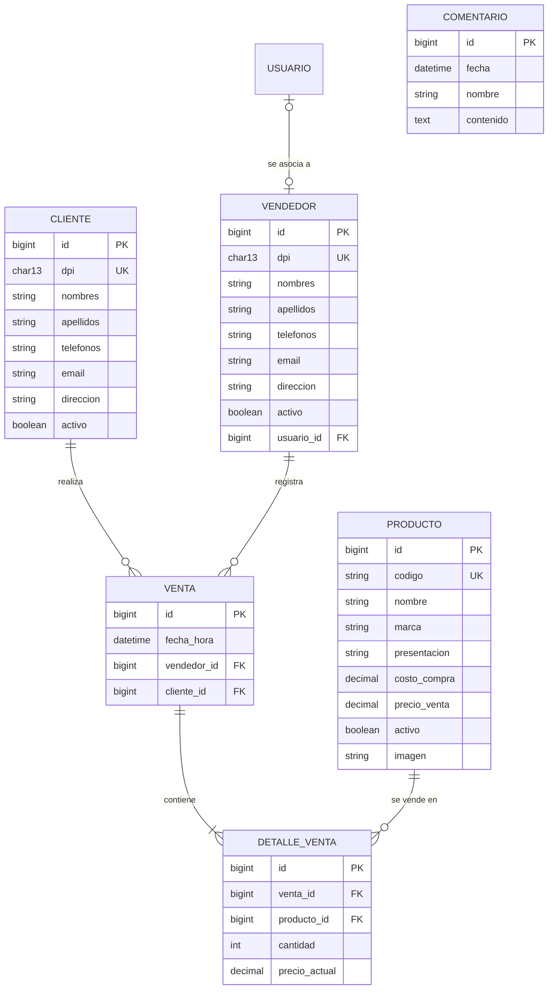

# Diagrama Entidad-Relación

**Notación elegida: pie de gallo (crow's foot).** Muestra en el mismo dibujo la cardinalidad (uno/muchos) y la opcionalidad (obligatorio/opcional) de cada relación, se traduce directamente a llaves foráneas y es la notación que usan Mermaid, dbdiagram.io y la mayoría de herramientas de modelado actuales.

## Notas
- `DETALLE_VENTA` resuelve la relación muchos a muchos entre `VENTA` y `PRODUCTO`; tiene restricción única (`venta`, `producto`).
- Todas las llaves foráneas usan `ON DELETE PROTECT` (Django), por lo que no se puede borrar un cliente, vendedor, producto o venta relacionados.
- `COMENTARIO` no se relaciona con otras entidades. `USUARIO` es el modelo de autenticación de Django.
- `CONFIGURACION_SITIO` (registro único con títulos y colores) tampoco se relaciona y se omite del diagrama.
